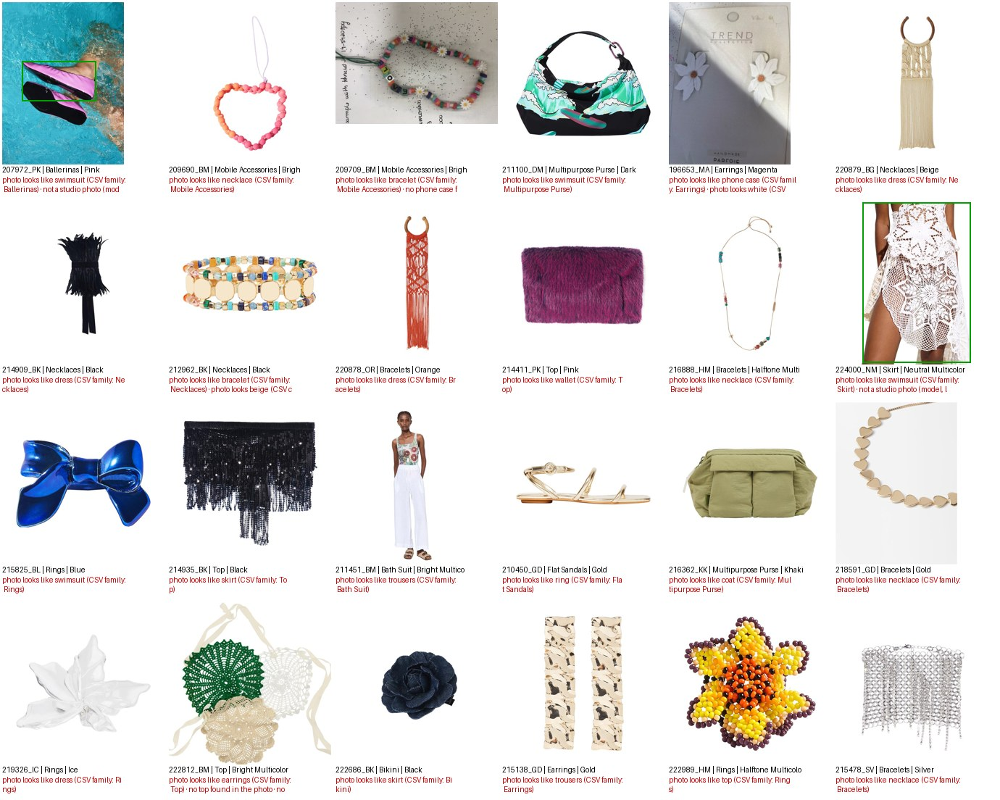
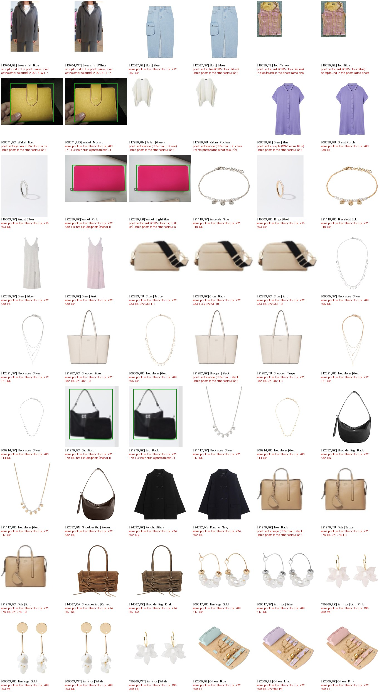

# Progress Log: Parfois Similarity Project

What has been done so far, with evidence, in date order. **Status and next steps are only in [roadmap.md](roadmap.md).**

---

## At a glance

| | |
|---|---|
| Products (SKUs / colourways) | 17,125 SKUs → **10,555 colourways** (model × colour), the unit of analysis |
| Photos | 9,496 files, **9,491 colourways (89.9%)** with a photo (33 wrong paths repaired) |
| Automatic checks | 21 checks on codes, text, images and sizes. **29 high, 578 medium, 351 low priority** products |
| Image AI | 9,490 photos masked and embedded (512 numbers each): 9,457 in 86 min on one laptop CPU, plus 33 repaired paths in 98 s |
| Image flags | **24** photos of another item type, **135** of another colour, **54** same photo for another colour |
| Review | 5 balanced batches (2,111 products each), browser app, autosave, one-click submit |
| Review merged | 10,290 ok, **147 fixed**, **118 wrong photos** unlinked, 0 discarded → `items_clean.parquet` (10,555 colourways) |
| Image flag precision | Colour flag **70%**, type mismatch 17%; image flags caught 47% of the problems in the fully reviewed batch |
| Features (Phase 2a) | 4 blocks: categorical (1,619 columns), composition (95 materials), numeric (price, launch, season), text (384-number sentence embedding) |
| Visual features (Phase 2b) | CLIP image embeddings + colour palettes for the 9,449 photos kept by the review |

---

## 1. Understanding the data (2026-10-07)

- **Data dictionary** for all 141 product columns and the sales file: [data.md](data.md).
- **Key findings:**
  - one row per SKU (size), so the work happens per colourway (`PROD_CLR_EQUIV`);
  - sales join with no orphans;
  - 33 columns are empty or constant;
  - hidden non-breaking spaces in the text.
- **Architecture decision:** a deterministic retrieval pipeline, **not a multi-agent system**: [roadmap.md § Architecture](roadmap.md#architecture-decision-no-multi-agent-system-mas-in-the-product).

## 2. Automatic checks (Phase 1, 2026-10-07 → 09)

- **Script:** `src/phase1_checks.py check`. It takes about 15 s on the full dataset.
- **Report:** [outputs/phase1/check_report.md](../outputs/phase1/check_report.md).
- **What it checks:**
  - **Keys and duplicates:** none found.
  - **Missing values:** a full table of empty and constant columns.
  - **Image paths and files:** 1 invalid path, 1 corrupt file, 1,100 colourways without a photo (1,064 after the path repair, see §9).
  - **Image file name vs product code, colour and category:** 252 generic photos, 100 shared photos.
  - **Colour code ↔ colour name ↔ description, and description type ↔ family.**
  - **Sizes of the same colourway that disagree:** 165 colourways, e.g. a different price or theme per size. The value most sizes share is used, and the product is flagged.
- **Audit by a teammate:** Pedro Meireles's AI audit ([archive/2026-10-09_phase1_audit.md](archive/2026-10-09_phase1_audit.md)) found 3 bugs. All were fixed on 2026-10-09.

## 3. Image pre-screen with AI (Phase 1b, 2026-10-09)

The professor warned that some photos don't match their row (e.g. the row says necklace, the photo shows earrings) and suggested **masks** for photos where a model wears several items.

**How:** `src/phase1b_image_audit.py`, run once on one laptop. Results are committed to `data/embeddings/`, so nobody else has to run it.

1. **Mask:**
   - white-background photos (97%) are cropped to the product;
   - photos of models, lifestyle shots and white-background photos with a person are cropped with an object detector (OWLv2), prompted with the CSV item type (e.g. "earrings").
2. **Embed:** each cropped product goes through CLIP and becomes **512 numbers** ("an image as a token"). Comparing products is then simple maths: all 90 million pairs take about 1 second.
3. **Check:**
   - item type (15 broad types) vs the CSV family;
   - colour vs `CLR_DES`;
   - the same photo used for another colour;
   - not a studio photo.
4. **Calibrate:** every flag type was inspected on contact sheets and the thresholds tuned. Flags fell from about 1,400 to about 700.

**Report:** [outputs/phase1b/image_audit_report.md](../outputs/phase1b/image_audit_report.md).

**Photos that look like another item type** (24 high-priority flags). Examples: a "bath suit" photo showing an outfit, a "top" that looks like a skirt, ballerinas photographed in a swimming pool:

**Same photo for another colour** (54). Examples: the white and the blue sweatshirt, the blue and the silver skirt, the black and the taupe bag share one photo:

**Photo shows another colour** (132): [contact sheet](../outputs/phase1b/vis_colour_mismatch.jpg).

**Not a studio photo** (272): [contact sheet](../outputs/phase1b/img_not_packshot.jpg).

These are **suggestions for the reviewers**, not verdicts. After the review, the decisions will measure each flag's real precision.

## 4. Review workflow for the team (2026-10-08 → 09)

- **Setup:** double-click `1_setup_windows.bat` / `1_setup_mac.command`. See [README.md](../README.md).
- **Review app:** double-click `2_review_…`, type your number, and the browser opens:
  - each product as a card with its photo, data and flags in plain words;
  - buttons: Looks right / Wrong photo / Fix data / Not sure / Discard;
  - every click saved automatically;
  - **Submit** sends your file to GitHub.

| # | Member | Batch |
|---|---|---|
| 1 | André | `batch_01_of_05` |
| 2 | Pedro Correia | `batch_02_of_05` |
| 3 | Pedro Meireles | `batch_03_of_05` |
| 4 | Manuel | `batch_04_of_05` |
| 5 | Zé | `batch_05_of_05` |

- **Merge:** `3_merge_…` applies all decisions and logs every change. It produces the clean dataset `data/processed/items_clean.parquet`, the Sprint 1 deliverable. Products still unresolved stay out until the team decides.

## 5. Compute strategy (2026-10-09)

**Encode once, reuse everywhere.**
- Heavy models run on one machine only.
- The results (≈10 MB of embeddings) are committed to the repository.
- Everyone else just loads small vectors: no GPU, no `torch`.

Details: [roadmap.md § Compute strategy](roadmap.md#compute-strategy-encode-once-reuse-everywhere).

## 6. Tests and CI (Phase 0, 2026-10-10)

- **`CLAUDE.md`:** conventions for AI agents (data rules, layout, commands, code style).
- **42 tests** in `tests/`, about 2 s, no vision packages needed:
  - **automatic checks** on a toy dataset (6 SKUs, 4 colourways): size collapsing, image, colour, type and sales flags, priorities;
  - **review workflow:** the batch split, never overwriting a reviewer's decisions, `merge` (fixes, discard, drop image, pending), and the review app's save rules;
  - **data contracts** on the committed files: embeddings vs their sidecar, keys of `masks`/`image_audit`, and the 5 review batches (valid decisions, every colourway in exactly one batch).
- **CI:** GitHub Actions runs `ruff` and `pytest` on Python 3.10 and 3.14 for every push to `parfois`. A teammate's batch with an invalid decision now turns the CI red before the merge.

## 7. Phase 1 cleaning and preview table (2026-10-10)

The human review hasn't happened yet, so everything that doesn't depend on it is done now.

- **Script:** `src/phase1_clean.py` (`finalise_items`). It takes about 1 s. `merge` runs the same function after applying the review decisions, so the official table and the preview have the same columns.
- **Preview:** `data/processed/items_preview.parquet`, 10,555 colourways × 109 columns. Later phases read it through `load_items()`, which switches to `items_clean.parquet` once the review is merged. Report and schema: [outputs/phase1/clean_report.md](../outputs/phase1/clean_report.md).
- **What it cleans:**
  - 61 columns dropped (empty, constant, duplicates, size-level);
  - 10 date columns in 3 formats parsed, none lost;
  - case variants merged (`THEME`: 153 values, e.g. `GOLDEN BASICS` → `Golden Basics`);
  - placeholders set to missing **only where they mean "no value"** (`DIMENSION`, `DISTRIBUTION_BLOCK`, `CATEGORY_MATRIX`). `PRINT_TYPE = Others` stays: it means a print outside the list, which is different from `No Print`;
  - sales features: `log_sales_qty`, `realised_price` (empty for the 9 items with 0 units), percentile within the category.
- **Photos, before any human review:**
  - `img_trusted`: the photo shows this product. **9,433 of 9,458** photos. The 25 left out are flagged as another item type, another model or a damaged file;
  - `img_colour_trusted`: its colour can also be trusted. **9,151**. Shared, generic or colour-mismatched photos are left out;
  - after `merge`, "Looks right" or "Fix data" accepts a photo and "Wrong photo" removes it. Items without a trusted photo use the tabular and text blocks only.
- **Tests:** 62 in total (20 new), including Phase 1's "done when" rule on the real data: unique key, all 10,185 sales rows joined, 10,555 rows.

## 8. Repository reorganised (2026-10-10)

The project was hard to follow: two numberings (sprints and phases) mixed in file names, 9 documents in the root and the status repeated in 3 places.

- **One numbering:** code and outputs use phases. `sprint1_preprocess.py` → `phase1_checks.py`, `outputs/sprint1/` → `outputs/phase1/`. Sprints remain only as the calendar in the roadmap.
- **Shared settings** (paths, item key, issue codes, team) moved to `src/config.py`.
- **Docs in `docs/`:** `roadmap.md` (the only place with the status), `progress.md` (this log), `review_guide.md`, `data.md`, `problem.md`. The README is now a short entry point with a documentation map.
- **Archived** in `docs/archive/`: the teammate audit of 2026-10-09 and the prompt used to produce it. A note at its top gives the status of each finding: 6 fixed, 1 partly, 7 still open. The open ones are now in the roadmap's Phase 1 checklist, so they aren't lost in the archive.
- The review batches moved unchanged (no decisions had been recorded yet).
- Fixed on the way: the review app showed raw image-check codes next to their plain-language note if a batch was regenerated after Phase 1b.

## 9. Image counts verified and review fixes normalised (2026-10-10)

**Are the "missing" photos real?** Checked from scratch:
- The CSV is read correctly: 17,125 rows = 17,125 lines in the file, 10,555 colourways, every row has an image path. 9,496 image files, all with different names.
- **33 image paths in the CSV are wrong:** they drop the colour code (`212983_2`) while the file has it (`212983_HM_1.jpg`). Each file matches exactly one colourway and nothing else used it. `check` now links them and flags them `IMG_PATH_REPAIRED` (medium) so a reviewer confirms the photo. No image file is left unused.
- **1,064 colourways really have no photo.** 91% are from the latest season (`242`), so the photos were not delivered. Coverage: 9,458 → **9,491 colourways (89.9%)**.
- **Phase 1b on the 33 repaired photos:** new mode `phase1b_image_audit.py --add-missing` embeds only the photos missing from `data/embeddings/` and keeps the stored vectors; the comparisons across all photos (neighbours, near-duplicates, flags) are recomputed on the full set. It took 98 s on CPU. Before using it, the full-set comparisons were recomputed on the stored data: identical flags on all 9,457 photos. Result: 3 new colour flags (e.g. `193076_PU`: CSV says purple, the earrings are teal; checked by eye), no flag changed on existing photos. 9,490 photos are embedded; only `216726_DM` (damaged file) is not.
- Photo trust after this: 9,466 photos trusted, 9,181 also for colour.

**Review fixes use fixed lists** (`src/phase1_vocab.py`), so 5 reviewers can't create 5 spellings of the same colour:
- a fix can only use values that already exist in the data: 100 colours, 416 category › family › sub-family combinations, finishing and material per category, 95 materials;
- the review app shows lists instead of free text, and the family list depends on the category; the description is no longer editable;
- if the right value isn't listed, the reviewer uses **Not sure** with a note;
- the app and `merge` both validate, so a CSV edited by hand can't bring in new values; `merge` stores them in the data's spelling (`yellow` → `Yellow`);
- the allowed values are in `outputs/phase1/review_vocabulary.csv`.
- The review batches were regenerated (no decisions had been recorded): same products per member, now with the repaired photos and the Phase 1b flags written in.
- Tests: 79 (17 new).

## 10. Phase 2a started: categorical block (2026-10-10)

Phase 2a starts on the preview table, without waiting for the photo review: it uses the CSV attributes, not the photos. `phase1_clean.load_items()` will return the reviewed table after `merge`, so the same script is simply rerun then.

- **`src/phase2a_features.py`** → `data/processed/features_categorical.npy` (10,555 × 1,620, float32) and `feature_meta.json` (row order, columns, weight and position of each attribute).
- **15 attributes**, one-hot with a weight each: family and sub-family 3, colour 2, category matrix, finishing and theme 1.5, category, material, print, dimension and outfit 1, colour type, fashion type, segment and units 0.5. These are starting values; Phase 4 tunes them.
- **Family and sub-family are encoded under their category** (`Jewellery › Others` ≠ `Apparel › Others`): 416 sub-family paths, the same list the review uses.
- **A missing value never counts as a match** (finishing is 48% filled, material 13%).
- **Explainable by construction:** rows are normalised, so the dot product of two rows is their cosine similarity, and each attribute's slice gives its share of the score (`shared_attributes`). Phase 5 can say "same sub-family, same colour, same theme" with the exact contribution of each.
- Sanity check in `outputs/phase2a/features_report.md`: the neighbours of 3 random items share sub-family and mostly colour and theme (e.g. silver pendant `217529_SV` → 4 silver pendants of the same theme, score 0.83–0.87).
- `NUMBER_OF_UNITS` added to the Phase 1 contract columns (it is used here).
- Tests: 86 (7 new).

## 11. Review merged: Phase 1 done (2026-10-11)

All 5 batches were submitted. Before the merge, the decisions were made consistent with the team rule agreed on 2026-10-10:
- **If the photo shows this product in another colour → Fix data with the photo's colour** (more labelled examples for the model). Wrong photo only when the photo shows another article, a sketch, a swatch or a damaged file, or the colour of a sibling colourway of the same model.
- 48 doubtful decisions in batches 2, 3 and 5 were re-checked on the photos: 22 became colour fixes, 8 became Looks right (flag was a false alarm), the others stayed Wrong photo. Every changed row has a note (`[2026-10-11, Manuel: X -> Y, team rule]`); the original reviewer is kept.
- All 7 Not sure items and the 1 Discard were resolved, so nothing is left out of the clean table.
- No colour fix creates two colourways of one model with the same colour, except 4 models in batch 5 that the team kept on purpose.

**`merge` result** (`python src/phase1_checks.py merge`):

| | Items |
|---|---|
| Looks right | 10,290 |
| Fix data | 147 (141 colours, 10 family/sub-family, 1 finishing) |
| Wrong photo (image unlinked) | 118 (76 of them had no photo file anyway) |
| Discarded / unresolved | 0 / 0 |

- `data/processed/items_clean.parquet`: 10,555 colourways, 9,449 with a trusted photo. Every change is in `outputs/phase1/changes_log.csv` (270 rows, with old value, new value and reviewer); report in `outputs/phase1/clean_report.md`.
- `load_items()` now returns the merged table. Phase 2a was rebuilt on it: categorical block 10,555 × 1,619 (one colour value fewer after the fixes).

## 12. Image flag precision (Phase 1b, 2026-10-11)

`python src/phase1b_precision.py` → `outputs/phase1b/flag_precision.md`. A flag is confirmed when the reviewer dropped the photo or fixed what it points at.

| Flag | Flagged | Precision | Target |
|---|---|---|---|
| `VIS_TYPE_MISMATCH` (high) | 24 | 17% | 80% ❌ |
| `VIS_COLOUR_MISMATCH` (medium) | 135 | **70%** | 50% ✅ |
| `IMG_NEAR_DUPLICATE` (medium) | 54 | 33% | 50% (about half expected: the shared photo is right for one colourway) |
| `VIS_TARGET_NOT_FOUND` (low) | 46 | 50% | – |

- **Colour flag: useful.** On batch 4 (every photo looked at), a looser cut (0.02 instead of 0.005) keeps precision at 51% and raises recall from 36% to 48%.
- **Type flags: mostly false alarms.** The 20 unconfirmed ones were checked on a contact sheet: feathers, fringes, beads, macramé and lifestyle photos that CLIP misreads. The reviewers were right.
- **Recall:** any image flag caught 47% of the 58 problems found in batch 4; the rest were found by eye (mostly close colours, e.g. blue vs turquoise).
- Thresholds were **not** changed: new flags on items already reviewed would be left pending by a new `merge`. The report gives the settings to use on a future dataset.

## 13. Phase 2a: composition and numeric blocks (2026-10-11)

`python src/phase2a_features.py` now builds 3 blocks in about 1 s (report: `outputs/phase2a/features_report.md`):

| Block | Shape | What it encodes |
|---|---|---|
| categorical | 10,555 × 1,619 | 15 product attributes, weighted one-hot |
| composition | 10,555 × 95 | materials, weighted by rarity (IDF): sharing "Pearl" counts more than sharing "Polyester" |
| numeric | 10,555 × 79 | price percentile **within the category** (weight 2), launch month (1), season (0.5) |

- Price and launch date are soft bands (Gaussian bumps): 10 price percentile points apart → similarity ≈ 0.78; 1 month apart → ≈ 0.89, 3 months → ≈ 0.37.
- Same contract for every block: unit-length rows (dot product = cosine) and named attribute slices that add up to the score, so Phase 5 can say e.g. "shares Zinc and Pearl, same price band".
- A data contract test now builds every block on the real data and checks it; it caught one block stored as float64 instead of float32.
- Tests: 93 (7 new).

## 14. Phase 2a: text block, Phase 2a done (2026-10-11)

- **`src/phase2a_text.py`** builds one English sentence per item from the reviewed attributes, e.g. *"Cocktail (Rings, Jewellery). Colour: Pastel Multicolor. Finish: Worn Gold. Made of Stone, Zinc. Theme: Nile. Fashion, Woman."*, and embeds it with `sentence-transformers/all-MiniLM-L6-v2` (384 numbers, mean pooling, unit length).
- Run once on the vision machine (54 s on CPU) → `data/embeddings/text.npy` (10,555 × 384, float16, 8 MB) + `text.json` (model, commit, template, row order). Committed, so nobody else needs torch.
- `phase2a_features.py` loads it as the 4th block (`text`), in the same row order as the others; it is skipped with a message if the file is missing.
- Why it helps on top of the categorical block: it sees that close labels are close (e.g. "Printed Fake Nylon" and "Fake Nylon", or theme names written differently), where one-hot only matches identical labels.
- Tests: 96 (3 new), including a data contract for `text.npy` vs its sidecar and the Phase 1 table.

## 15. Phase 2b: colour palettes, Phase 2b done (2026-10-11)

- **`src/phase2b_palettes.py`**: for each photo kept by the review, k-means (k = 4, fixed seed) in CIELAB on the product pixels: inside the Phase 1b item box, without the near-white background. Clusters under 5% are dropped.
- 9,449 photos in 2.5 min on the light environment (no torch) → `data/embeddings/palettes.parquet` + `.json` (committed). Per item: colours as hex and LAB, their shares, the nearest of 24 colour names, and a `palette_vector` (shares per name, unit length) whose dot product is a palette similarity that can be explained ("both mostly black and white").
- Checked by eye on `outputs/phase2b/palettes_sample.jpg`: the swatches match the photos. 9,197 palettes come from packshots (`reliable`); the others (model / lifestyle photos) keep some background.
- **Limitation:** metals look like light neutrals (a gold item's main cluster is its highlights: L 86, b 15, like beige or ecru), so a colour name can't tell gold from beige. The metal comes from `FINISHING` in the CSV; palette similarity is unaffected.
- Tests: 101 (5 new), including a data contract for `palettes.parquet`.

**Every input of Phase 3 is now ready:** 4 tabular/text blocks (`data/processed/features_*.npy`), CLIP image embeddings and colour palettes (`data/embeddings/`), and the photo trust columns of `items_clean.parquet`.

## 16. Missing attributes filled where reliable (Phase 2a, 2026-10-11)

Only items **with a trusted photo** are filled; items without a photo are left out. Fields are filled only in the categories where they exist: `FINISHING` is empty for apparel and footwear because it doesn't apply to them, and `MATERIAL` only exists for apparel.

| Gap (items with a photo) | How | Measured precision | Filled |
|---|---|---|---|
| `MATERIAL`, apparel (778) | 1. another colourway of the same model has it · 2. the composition is a single material · 3. vote of the 15 most similar items (vote share ≥ 0.8) | 99.7% · 98% · 92–95% | **581** (75%) |
| `FINISH_FAMILY`, jewellery (417) | vote of the 15 most similar items, accepted only if the photo agrees (gold must look yellowish, silver must not) | 97% (gold 97%, silver 91%) | **266** (64%) |
| Detailed `FINISHING`, jewellery | – | ≈ 88% on only 30% | not filled |
| `FINISHING`, hand bags | – | ≈ 77% | not filled |

- Precision is measured by 5-fold cross-validation **grouped by model**, so a colourway never learns from its own siblings. A value is only filled if its own precision is ≥ 90% (e.g. Linen 81% and Polyamide 71% are not filled by the neighbours).
- Checked by eye on a sample sheet: two silver items first filled as gold led to the photo check (gold is 79% of the jewellery, so the vote leaned to gold).
- `FINISH_FAMILY` is also a new categorical attribute (weight 1): two items with "Golden" and "Worn Gold" now get partial credit.
- Nothing in the CSV or in `items_clean.parquet` changes: the values live in `data/processed/attributes_inferred.parquet` with method and confidence, and `phase2a_features.py` uses them where the CSV is empty.
- Tests: 108 (7 new), including a data contract (never replaces a value, only items with a photo, only known values).

## 17. Every photo checked (Phase 1, 2026-10-12)

Before, only flagged photos had been looked at in batches 1, 2, 3 and 5 (6,912 photos never seen). Batch 4 had shown that about 3% of unflagged photos have a problem, so all 6,912 were checked one by one on contact sheets of 12.

- **Rule used:** fix only clear colour-family changes (e.g. CSV "Blue", photo turquoise; CSV "Pink", photo fuchsia; CSV "Midnight Blue", photo light pink stone). Close shades (ecru / beige / white, taupe / brown / camel, grey shades) were left as they are, so the fixes stay reliable.
- **Result:** 314 colour fixes and 4 wrong photos (3 show a sibling colourway's colour, 1 a different article); the rest are ok. Every changed row has a note `[2026-10-12, Manuel: full photo check, team rule]`.
- Most common errors: "Blue" for turquoise or teal items (jewellery and wallets), "Pink" for fuchsia, "Green" for lime or teal, and pastel names for strong colours.
- **Merge now:** 9,972 ok, **461 fixed**, 122 wrong photos, 0 unresolved; 588 changes in `changes_log.csv` (455 colours). 9,445 photos trusted.
- **What it says about the automatic flags:** they caught only 28% of the 506 photo problems found by eye (`outputs/phase1b/flag_precision.md`). A review of flagged items alone would have missed most of them.
- Phase 2a features, inferred attributes and Phase 2b palettes were rebuilt on the new table. Tests: 108.

## 18. Similarity engine (Phase 3, 2026-10-12)

`src/phase3_engine.py build` returns the 10 most similar colourways for each of the 10,555 colourways in about 7 seconds (light environment, no torch).

- **Score:** weighted sum of the cosine similarity of six blocks: image 0.30, categorical 0.30, text, composition, palette and numeric 0.10 each (`src/phase3_weights.json`, starting values for Phase 4). A pair is scored on the blocks both items have, with the weights rescaled, so an item without a trusted photo is matched on its tabular blocks and is not penalised.
- **Candidates:** same category, never the item itself and never another colour of the same model (`PROD_REF` or `PROD_REF_EQUIV`).
- **Coverage:** every colourway has at least 4 neighbours (0 with fewer).
- **First sanity check (top 4):** same family 91–99%, same sub-family 76–91%, same colour 42–66%, median price ratio 1.00–1.08 (`outputs/phase3/engine_report.md`). Items without a photo get similar agreement (sub-family 88%).
- **By eye:** `outputs/phase3/examples.jpg` (12 random queries): matches share the sub-family, shape and finish; colour varies more in apparel.
- **Finding:** 72 queries have a best match scoring ≥ 0.99, mostly the same design under another model code. They are kept; Phase 4 should check whether buyers see them as duplicates.
- Each neighbour row stores `sim_<block>` and `contrib_<block>` (the contributions add up to the score), ready for the Phase 5 explanations.
- Tests: 116 (7 unit tests on toy blocks + a data contract on `neighbours.parquet`).
