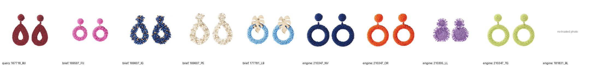

# The brief's example: 167718_BU

Generated by `src/phase6_deliver.py brief` (2026-10-28) from the Phase 3 neighbours and Phase 5 explanations. Photos: `brief_example.jpg` (query, the brief's four answers, the engine's top 5).

| | in | sub-family | theme | finish | colour | price € | season | model | engine rank |
|---|---|---|---|---|---|---|---|---|---|
| 167718_BU | query | Dangle | STARRY NIGHT | Golden | Burgundy | 8.99 | 232 | 167718 | – |
| 169597_FU | brief | Dangle | DEGRADÊ | Other | Fuchsia | 5.99 | 232 | 169597 | 269 |
| 169607_IG | brief | Dangle | DEGRADÊ | Other | Indigo | 8.99 | 232 | 169607 | 30 |
| 169607_PE | brief | Dangle | DEGRADÊ | Other | Pearl | 8.99 | 232 | 169607 | 56 |
| 177781_LB | brief | Stud | DEGRADÊ | Golden | Light Blue | 6.99 | 232 | 177781 | 575 |
| 210347_NV | engine | Dangle | STARRY NIGHT | Golden | Navy | 8.99 | 232 | 210347 | 1 |
| 210347_OR | engine | Dangle | DEGRADÊ | Golden | Orange | 8.99 | 232 | 210347 | 2 |
| 210305_LL | engine | Dangle | DEGRADÊ | Golden | Lilac | 8.99 | 232 | 210305 | 3 |
| 210347_TG | engine | Dangle | WATERMELON PARTY | Golden | Pastel Green | 8.99 | 242 | 210347 | 4 |
| 181831_BL | engine | Dangle | GUMMY PARTY | Golden | Blue | 7.99 | 232 | 181831 | 5 |

What matches the query (out of 4 brief answers / 5 engine answers):

| | brief | engine |
|---|---|---|
| same sub-family | 3 / 4 | 5 / 5 |
| same theme | 0 / 4 | 1 / 5 |
| same finish | 1 / 4 | 5 / 5 |
| different models | 3 | 3 |

- The brief lists `117781_LB`, which is not in the data; `177781_LB` is (one digit differs), and its photo is the one on the slide, so it is used here.
- The engine ranks the brief's answers 269 / 30 / 56 / 575 of 4,638 candidates of the category.
- Both lists are beaded earrings (see the photos). The engine's are dangle earrings with the query's golden finish and price; the brief's are mostly another theme (DEGRADÊ), finish *Other*, and one is a stud. The difference is one of criterion, not an error of either list.
- Both lists repeat a model in several colours (the brief 169607 twice, the engine 210347 three times); whether colours of one model should count as one suggestion is open (a question for the professor).
- One example cannot evaluate an engine: it is a sanity check of the format. The evaluation is the team's sorted answers on 99 queries (Phase 4).
